<a href="./README.md">🇬🇧 Read in English</a> · <a href="https://amet.dev">Sitio web</a> · <a href="https://www.linkedin.com/in/aamet">LinkedIn</a> · <a href="mailto:quispeamet2@gmail.com">Email</a>

<h2 align="center">Sistemas backend para flujos de negocio reales.</h2>

Personalizo Odoo, construyo servicios en Python y conecto los sistemas que mantienen un negocio en movimiento. Desde Lima, Perú · Disponible para colaborar en open source y resolver problemas interesantes.

ERP → APIs → Datos → Cloud

## Qué construyo

| Área | Qué hago |
| --- | --- |
| **Odoo y ERP** | Módulos personalizados, integraciones, flujos y migraciones Enterprise |
| **Backend** | Servicios en Python, APIs, bases de datos y lógica de negocio mantenible |
| **Entrega e infraestructura** | Docker, CI/CD, despliegues cloud y herramientas para desarrollo |
| **Pensamiento sistémico** | Convertir flujos de negocio en software mantenible |

## Cómo trabajo

- **Entiendo el flujo** antes de elegir la tecnología.
- **Integro los sistemas correctos** sin añadir complejidad innecesaria.
- **Entrego software mantenible** con límites claros y despliegues confiables.

## Herramientas

**Backend:** `Python` · `Odoo` · `PostgreSQL` · `MySQL` · `Node.js` · `Laravel` · `Flask` · `.NET`

**Frontend:** `JavaScript` · `TypeScript` · `React` · `Next.js` · `Vue` · `HTML` · `CSS`

**Entrega:** `Docker` · `Kubernetes` · `AWS` · `Azure` · `OpenShift` · `Keycloak` · `Git` · `Linux`

<strong>Otras herramientas</strong>
 Power BI · Azure DevOps · WordPress · Google Analytics · Scrum

## En este momento

- Desarrollando y manteniendo **módulos e integraciones para Odoo**.
- Profundizando en **React, Next.js y arquitecturas cloud-native**.
- Buscando colaborar en **proyectos open source de Odoo y herramientas para desarrolladores**.

Siempre aprendiendo. Siempre entregando algo un poco mejor.

