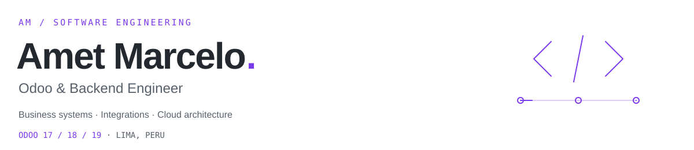
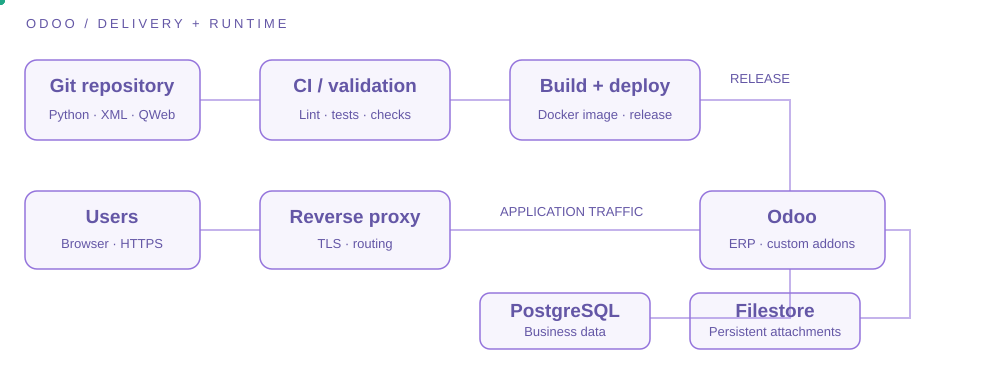

<picture>
  <source media="(prefers-color-scheme: dark)" srcset="./assets/header.svg" />
  
</picture>

<a href="./README.md">[ EN ] Read in English</a> · <a href="https://amet.dev">Sitio web</a> · <a href="https://www.linkedin.com/in/aamet">LinkedIn</a> · <a href="mailto:quispeamet2@gmail.com">Email</a>

<h2 align="center">Convierto procesos de negocio complejos en sistemas backend claros.</h2>

Empiezo por Odoo: entiendo el flujo, elimino la fricción y construyo las integraciones que hacen que la operación funcione mejor. Python como base · Cloud cuando aporta · Lima, Perú

Arquitectura ilustrativa · Los puntos representan despliegues y solicitudes. CI valida los cambios antes del despliegue; Odoo persiste los datos en PostgreSQL y los adjuntos en el filestore.

## Experiencia aplicada

### Altamira Technology · Implementaciones Odoo

Trabajé para **Altamira Technology**, participando en implementaciones de Odoo para **Chanaltín, Neomed y Vape Station**. Mi experiencia abarca adaptación de módulos e integración de procesos empresariales; actualmente implemento Odoo **17, 18 y 19** para empresas peruanas.

[Conocer Altamira One](https://altamiraone.pe/nosotros) · [Referencias de implementación](https://www.altamiraone.pe/)

<table>
  <tr><td valign="top"><h3>AndeanVet</h3><strong>Localización peruana · RR. HH. · Nómina</strong>
Trabajé ampliamente en la localización y personalización de recursos humanos y nómina, adaptando Odoo a las necesidades de la empresa.
</td></tr>
  <tr><td valign="top"><h3>Neomed</h3><strong>Implementación integral de Odoo</strong>
Participé en toda la implementación, incluyendo la adaptación de la solución y sus personalizaciones a los procesos de la empresa.
</td></tr>
  <tr><td valign="top"><h3>Solemsac / Soluciones de Empaque</h3><strong>Implementación integral de Odoo</strong>
Trabajé en toda la implementación del ERP, adaptando la plataforma a las necesidades operativas del negocio.
</td></tr>
</table>

Parte de esta experiencia corresponde a proyectos internos y repositorios privados. Los casos describen mi participación en la implementación y personalización; incluyen trabajo sobre módulos propios y de terceros.

He trabajado en proyectos de distintos tipos —implementaciones ERP, ecommerce, inventarios, APIs, automatización y entregas cloud—. Esa variedad define mi forma de construir: primero entiendo la operación y luego conecto las piezas correctas.

<table>
  <tr>
    <td width="33%" valign="top"> <strong>ERP en producción</strong> Implementando Odoo 17, 18 y 19 para empresas peruanas, adaptando módulos y flujos a cada operación.</td>
    <td width="33%" valign="top"> <strong>Operaciones conectadas</strong> Ventas, inventario, ecommerce, facturación y logística convertidos en procesos más claros.</td>
    <td width="33%" valign="top"> <strong>Entrega cloud</strong> Despliegues automatizados y arquitecturas diseñadas para crecer sin perder claridad.</td>
  </tr>
</table>

## Más experiencia · Software, automatización y datos

<table>
<tr><td valign="top"><h3><a href="https://www.worki360.com/">Worki360</a></h3><strong>Implementación · Correcciones · Soporte · Ads</strong>
Trabajé en la implementación de soluciones, corrección de incidencias y apoyo al soporte. También contribuí con mejoras de posicionamiento y publicidad digital (Ads).
</td></tr>
<tr><td valign="top"><h3><a href="https://wazabot.pe/">Wazabot</a></h3><strong>Experiencia en plataformas de comunicación</strong>
Trabajé en Wazabot. Mi experiencia adicional incluye chatbots, scripts y automatizaciones para Telegram y consumo de datos para distintas empresas.
</td></tr>
</table>

### Automatización e integración

Scripts y flujos para Telegram, chatbots e integración de fuentes de datos para distintas empresas. Trabajo orientado a conectar herramientas, reducir tareas repetitivas y facilitar el acceso a información operativa.

### Analítica financiera · Power BI

Trabajé con dashboards de finanzas y tesorería en Power BI, orientados a visualizar información financiera y apoyar el seguimiento de la operación y la toma de decisiones.

### MetaTrader 5 · Automatización de operaciones

Trabajé con automatizaciones y flujos de compra y venta en MT5. Esta experiencia se centra en procesos técnicos de operación; los detalles de estrategias, ejecución y resultados se documentarán por proyecto.

## Proyectos independientes seleccionados

Desarrollo productos SaaS, ecommerce y plataformas de gestión para necesidades concretas. Selección de proyectos publicados en [amet.dev](https://amet.dev/).

<table>
<tr>
<td width="50%" valign="top"><h3>Imporisel</h3><strong>Software que evoluciona con el negocio</strong>
Plataforma comercial de repuestos diésel, con mejoras posteriores en control de inventario y personalización de órdenes de venta.
<a href="https://imporisel.com/">Visitar Imporisel →</a></td>
<td width="50%" valign="top"><h3>Bodapass</h3><strong>Producto digital personalizable</strong>
Plataforma de invitaciones digitales de boda, con diseños personalizados y una experiencia adaptada a móviles, tablets y ordenadores.
<a href="https://bodapass.com/">Explorar Bodapass →</a></td>
</tr><tr>
<td valign="top"><h3>Entryx</h3>
Gestión de eventos, tickets y control de asistencia: aforo, registro personalizado, exportaciones y seguimiento.
<a href="https://entryx.pe/">Explorar Entryx →</a></td>
<td valign="top"><h3>Centro Joyero</h3>
Ecommerce de joyería con catálogo y experiencia de marca. Desarrollado con React y Vite.
<a href="https://centrojoyero.com.pe/">Visitar Centro Joyero →</a></td>
</tr>
</table>

<table>
<tr><td valign="top"><h3>EPIK Project</h3><strong>Eventos · Música electrónica · Comunidad</strong>
Plataforma web para presentar eventos y experiencias de música electrónica, con galería, comunidad y acceso de usuarios. Una experiencia digital orientada a conectar la marca con su audiencia y promover sus eventos.
<a href="https://epik-project.com/">Visitar EPIK Project →</a></td></tr>
</table>

Más proyectos y capturas en [mi portafolio](https://amet.dev/).

### Arquitectura AWS · Caso técnico

<table>
  <tr><td width="15%" align="center"></td><td><strong>Arquitectura CI/CD sobre AWS</strong> GitHub Actions, Amplify, EC2, API Gateway, Aurora/RDS, Redis y S3 trabajando juntos en un flujo de entrega claro. <a href="https://www.linkedin.com/feed/update/urn:li:activity:7481566963144564736/">Ver el análisis de la arquitectura en LinkedIn →</a></td></tr>
</table>

## El trabajo detrás de la pantalla

<table>
  <tr>
    <td width="50%" valign="top"><h3> Ordenar el flujo</h3>
Módulos Odoo, migraciones ERP y reglas de negocio que sí se entienden.
</td>
    <td width="50%" valign="top"><h3> Conectar la operación</h3>
APIs Python, integraciones y flujos de datos entre las herramientas de un equipo.
</td>
  </tr>
  <tr>
    <td width="50%" valign="top"><h3> Hacerlo confiable</h3>
PostgreSQL, Docker, CI/CD y cloud con menos sorpresas.
</td>
    <td width="50%" valign="top"><h3> Seguir aprendiendo</h3>
Experimentos con React, Next.js y arquitecturas cloud-native.
</td>
  </tr>
</table>

## Mi brújula de ingeniería

<strong>Entender → Integrar → Automatizar → Mejorar</strong>

<table>
  <tr><td> <strong>Primero el negocio</strong></td><td>La mejor arquitectura facilita el flujo real.</td></tr>
  <tr><td> <strong>Simple donde importa</strong></td><td>Límites claros, datos previsibles y código mantenible.</td></tr>
  <tr><td> <strong>Curiosidad con propósito</strong></td><td>Aprendo herramientas nuevas cuando resuelven un problema real.</td></tr>
</table>

## Herramientas

<strong>BACKEND</strong>　 Python · Odoo · PostgreSQL · MySQL · Node.js · Laravel · Flask · .NET <strong>FRONTEND</strong>　 JavaScript · TypeScript · React · Next.js · Vue · HTML · CSS <strong>ENTREGA</strong>　 Docker · Kubernetes · AWS · Azure · OpenShift · Keycloak · Git · Linux

<strong>Otras herramientas</strong>
 Power BI · Azure DevOps · WordPress · Google Analytics · Scrum

## En este momento

<table>
  <tr><td></td><td><strong>Construyendo</strong> Módulos e integraciones Odoo para flujos de negocio reales.</td></tr>
  <tr><td></td><td><strong>Aprendiendo</strong> React, Next.js y arquitecturas cloud-native.</td></tr>
  <tr><td></td><td><strong>Buscando</strong> Colaboraciones open source de Odoo y herramientas para desarrolladores.</td></tr>
</table>

<strong>Construyendo los sistemas invisibles que mantienen en movimiento el trabajo visible.</strong>

