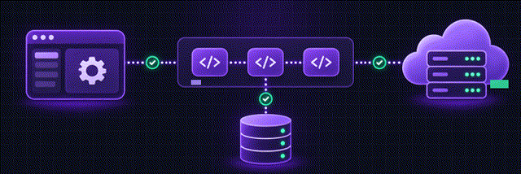
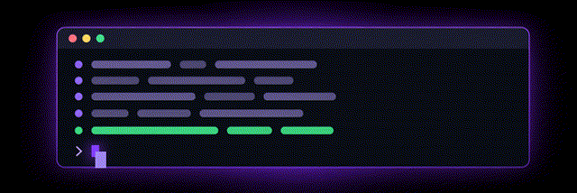

<a href="./README.md">🇬🇧 Read in English</a> · <a href="https://amet.dev">Sitio web</a> · <a href="https://www.linkedin.com/in/aamet">LinkedIn</a> · <a href="mailto:quispeamet2@gmail.com">Email</a>

<h2 align="center">Convierto procesos de negocio complejos en sistemas backend claros.</h2>

Empiezo por Odoo: entiendo el flujo, elimino la fricción y construyo las integraciones que hacen que la operación funcione mejor. Python como base · Cloud cuando aporta · Lima, Perú

ERP → APIs → Datos → Cloud

## El trabajo detrás de la pantalla

| Área | Qué hago |
| --- | --- |
| **Ordenar el flujo** | Módulos Odoo, migraciones ERP y reglas de negocio que sí se entienden |
| **Conectar la operación** | APIs Python, integraciones y flujos de datos entre las herramientas de un equipo |
| **Hacerlo confiable** | PostgreSQL, Docker, CI/CD y cloud con menos sorpresas |
| **Seguir aprendiendo** | Experimentos con React, Next.js y arquitecturas cloud-native |

## Mi brújula de ingeniería

- **Primero el negocio.** La mejor arquitectura es la que facilita el flujo real.
- **Simple donde importa.** Límites claros, datos previsibles y código mantenible.
- **Curiosidad con propósito.** Aprendo herramientas nuevas cuando resuelven un problema real.

## Herramientas

**Backend:** `Python` · `Odoo` · `PostgreSQL` · `MySQL` · `Node.js` · `Laravel` · `Flask` · `.NET`

**Frontend:** `JavaScript` · `TypeScript` · `React` · `Next.js` · `Vue` · `HTML` · `CSS`

**Entrega:** `Docker` · `Kubernetes` · `AWS` · `Azure` · `OpenShift` · `Keycloak` · `Git` · `Linux`

<strong>Otras herramientas</strong>
 Power BI · Azure DevOps · WordPress · Google Analytics · Scrum

## En este momento

- Desarrollando y manteniendo **módulos e integraciones para Odoo**.
- Profundizando en **React, Next.js y arquitecturas cloud-native**.
- Buscando colaborar en **proyectos open source de Odoo y herramientas para desarrolladores**.

<strong>Construyendo los sistemas invisibles que mantienen en movimiento el trabajo visible.</strong>

