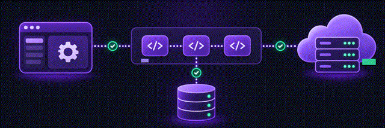
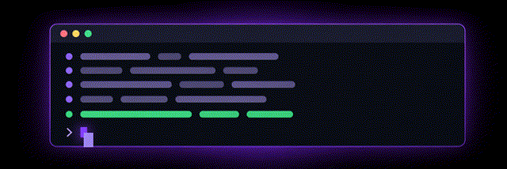

<a href="./README.es.md">🇪🇸 Leer en español</a> · <a href="https://amet.dev">Website</a> · <a href="https://www.linkedin.com/in/aamet">LinkedIn</a> · <a href="mailto:quispeamet2@gmail.com">Email</a>

<h2 align="center">I turn messy business processes into clean backend systems.</h2>

Odoo is where I start: I map the workflow, remove the friction and build the integrations that make the operation feel effortless. Python at the core · Cloud when it helps · Lima, Peru

ERP → APIs → Data → Cloud

## The work behind the screen

| Focus | What that looks like |
| --- | --- |
| **Untangle the workflow** | Custom Odoo modules, ERP migrations and business rules that make sense |
| **Connect the operation** | Python APIs, integrations and data flows between the tools a team already uses |
| **Make it dependable** | PostgreSQL, Docker, CI/CD and cloud delivery with fewer surprises |
| **Keep learning in public** | Small experiments in React, Next.js and cloud-native architecture |

## My engineering north star

- **Business first.** The best architecture is the one that makes the real workflow easier.
- **Boring where it matters.** Clear boundaries, predictable data and code people can maintain.
- **Curious by default.** I like learning new tools, but only when they solve a real problem.

## Toolkit

**Backend:** `Python` · `Odoo` · `PostgreSQL` · `MySQL` · `Node.js` · `Laravel` · `Flask` · `.NET`

**Frontend:** `JavaScript` · `TypeScript` · `React` · `Next.js` · `Vue` · `HTML` · `CSS`

**Delivery:** `Docker` · `Kubernetes` · `AWS` · `Azure` · `OpenShift` · `Keycloak` · `Git` · `Linux`

<strong>Other tools</strong>
 Power BI · Azure DevOps · WordPress · Google Analytics · Scrum

## Current direction

- Building and maintaining **Odoo modules and integrations**.
- Deepening my knowledge of **React, Next.js and cloud-native architecture**.
- Looking to collaborate on **open-source Odoo and developer-tooling projects**.

<strong>Building the invisible systems that keep visible work moving.</strong>

