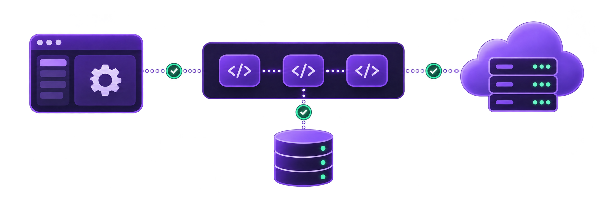
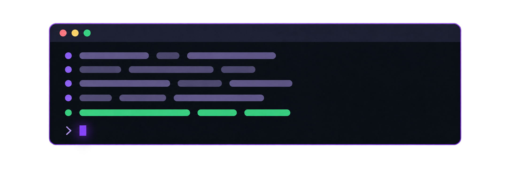

<picture>
  <source media="(prefers-color-scheme: dark)" srcset="./assets/header.svg" />
  
</picture>

<a href="./README.es.md">[ ES ] Leer en español</a> · <a href="https://amet.dev">Website</a> · <a href="https://www.linkedin.com/in/aamet">LinkedIn</a> · <a href="mailto:quispeamet2@gmail.com">Email</a>

<h2 align="center">I turn messy business processes into clean backend systems.</h2>

Odoo is where I start: I map the workflow, remove the friction and build the integrations that make the operation feel effortless. Python at the core · Cloud when it helps · Lima, Peru

ERP → APIs → Data → Cloud

## Experience in the field

### Altamira Technology · Odoo implementations

I worked for **Altamira Technology**, contributing to Odoo implementations for **Chanaltín, Neomed and Vape Station**. My experience spans module customization and business process integration; I currently implement Odoo **17, 18 and 19** for Peruvian companies.

[About Altamira One](https://altamiraone.pe/nosotros) · [Implementation references](https://www.altamiraone.pe/)

<table>
  <tr><td valign="top"><h3>AndeanVet</h3><strong>Peruvian localization · HR · Payroll</strong>
Worked extensively on localization and HR and payroll customization, adapting Odoo to the company's requirements.
</td></tr>
  <tr><td valign="top"><h3>Neomed</h3><strong>End-to-end Odoo implementation</strong>
Contributed throughout the implementation, adapting the solution and its customizations to the company's business processes.
</td></tr>
  <tr><td valign="top"><h3>Solemsac / Soluciones de Empaque</h3><strong>End-to-end Odoo implementation</strong>
Worked throughout the ERP implementation, adapting the platform to the operational needs of the business.
</td></tr>
</table>

Some of this experience comes from internal projects and private repositories. These cases describe my implementation and customization work, including work with both custom and third-party modules.

I have worked across different kinds of projects — ERP implementations, ecommerce, inventory, APIs, automation and cloud delivery. That variety shaped the way I build: understand the operation first, then connect the right pieces.

<table>
  <tr>
    <td width="33%" valign="top"> <strong>ERP in production</strong> Implementing Odoo 17, 18 and 19 for Peruvian companies, adapting modules and workflows to each operation.</td>
    <td width="33%" valign="top"> <strong>Connected operations</strong> Sales, inventory, ecommerce, invoicing and logistics connected into clearer processes.</td>
    <td width="33%" valign="top"> <strong>Cloud delivery</strong> Automated deployments and architectures designed to stay understandable as they grow.</td>
  </tr>
</table>

## More experience · Software, automation and data

<table>
<tr><td valign="top"><h3><a href="https://www.worki360.com/">Worki360</a></h3><strong>Implementation · Fixes · Support · Ads</strong>
Worked on solution implementation, issue resolution and support assistance. Also contributed to improvements in digital visibility and advertising (Ads).
</td></tr>
<tr><td valign="top"><h3><a href="https://wazabot.pe/">Wazabot</a></h3><strong>Experience with communication platforms</strong>
Worked at Wazabot. My broader experience includes chatbots, Telegram scripts and automation, and consuming data sources for different companies.
</td></tr>
</table>

### Automation and integration

Telegram scripts and workflows, chatbots and data source integrations for different companies. Work focused on connecting tools, reducing repetitive tasks and making operational information accessible.

### Financial analytics · Power BI

Worked with finance and treasury dashboards in Power BI to visualize financial information and support operational monitoring and decision-making.

### MetaTrader 5 · Trading workflow automation

Worked with automation and buy/sell workflows in MT5. This experience focuses on technical operational processes; strategy, execution and outcome details will be documented per project.

## Selected independent projects

I build SaaS products, ecommerce and management platforms around concrete business needs. Selected work published on [amet.dev](https://amet.dev/).

<table>
<tr>
<td width="50%" valign="top"><h3>Imporisel</h3><strong>Software that grows with the business</strong>
Commercial platform for diesel parts, with subsequent improvements to inventory control and sales order customization.
<a href="https://imporisel.com/">Visit Imporisel →</a></td>
<td width="50%" valign="top"><h3>Bodapass</h3><strong>A customizable digital product</strong>
Digital wedding invitation platform with personalized designs and an experience adapted to phones, tablets and desktops.
<a href="https://bodapass.com/">Explore Bodapass →</a></td>
</tr><tr>
<td valign="top"><h3>Entryx</h3>
Event management, tickets and attendance control with capacity settings, custom registration and attendee exports.
<a href="https://entryx.pe/">Explore Entryx →</a></td>
<td valign="top"><h3>Centro Joyero</h3>
Jewelry ecommerce with a product catalog and branded shopping experience. Built with React and Vite.
<a href="https://centrojoyero.com.pe/">Visit Centro Joyero →</a></td>
</tr>
</table>

More projects and screenshots on [my portfolio](https://amet.dev/).

### AWS architecture · Technical case

<table>
  <tr><td width="15%" align="center"></td><td><strong>AWS CI/CD architecture</strong> GitHub Actions, Amplify, EC2, API Gateway, Aurora/RDS, Redis and S3 working together in a clear delivery flow. <a href="https://www.linkedin.com/feed/update/urn:li:activity:7481566963144564736/">Read the architecture breakdown on LinkedIn →</a></td></tr>
</table>

## The work behind the screen

<table>
  <tr>
    <td width="50%" valign="top"><h3> Untangle the workflow</h3>
Custom Odoo modules, ERP migrations and business rules that make sense.
</td>
    <td width="50%" valign="top"><h3> Connect the operation</h3>
Python APIs, integrations and data flows between the tools a team already uses.
</td>
  </tr>
  <tr>
    <td width="50%" valign="top"><h3> Make it dependable</h3>
PostgreSQL, Docker, CI/CD and cloud delivery with fewer surprises.
</td>
    <td width="50%" valign="top"><h3> Keep learning in public</h3>
Small experiments in React, Next.js and cloud-native architecture.
</td>
  </tr>
</table>

## My engineering north star

<strong>Understand → Integrate → Automate → Improve</strong>

<table>
  <tr><td> <strong>Business first</strong></td><td>The best architecture makes the real workflow easier.</td></tr>
  <tr><td> <strong>Simple where it matters</strong></td><td>Clear boundaries, predictable data and maintainable code.</td></tr>
  <tr><td> <strong>Curious by default</strong></td><td>New tools only matter when they solve a real problem.</td></tr>
</table>

## Toolkit

<strong>BACKEND</strong>　 Python · Odoo · PostgreSQL · MySQL · Node.js · Laravel · Flask · .NET <strong>FRONTEND</strong>　 JavaScript · TypeScript · React · Next.js · Vue · HTML · CSS <strong>DELIVERY</strong>　 Docker · Kubernetes · AWS · Azure · OpenShift · Keycloak · Git · Linux

<strong>Other tools</strong>
 Power BI · Azure DevOps · WordPress · Google Analytics · Scrum

## Current direction

<table>
  <tr><td></td><td><strong>Building</strong> Odoo modules and integrations for real business workflows.</td></tr>
  <tr><td></td><td><strong>Learning</strong> React, Next.js and cloud-native architecture.</td></tr>
  <tr><td></td><td><strong>Looking for</strong> Open-source Odoo and developer-tooling collaborations.</td></tr>
</table>

<strong>Building the invisible systems that keep visible work moving.</strong>

